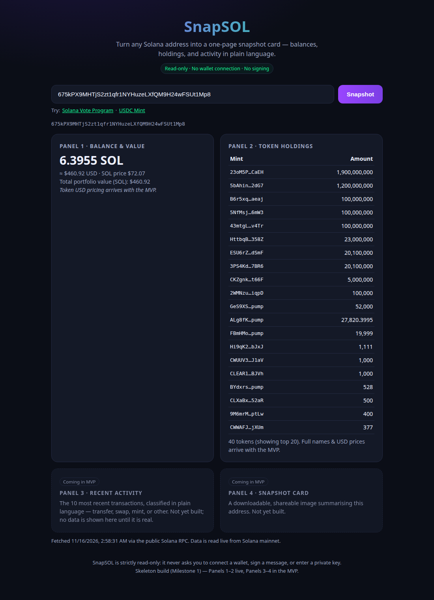

# SnapSOL — Solana Wallet Snapshot Card

A free, **read-only** web tool that turns any Solana address into a one-page
snapshot card: SOL balance and portfolio value in USD, top token holdings,
recent activity in plain language, and a shareable summary card.

**Strictly read-only by design.** SnapSOL never asks you to connect a wallet,
sign a message, or enter a private key. It only reads public on-chain data,
so there is no custody or phishing risk.



## Status — Milestone 1 (skeleton)

| Panel | State |
|---|---|
| 1 · SOL balance + total portfolio value in USD | ✅ Live against mainnet |
| 2 · Top SPL token holdings (legacy + Token-2022, merged per mint) | ✅ Live (amounts; USD prices in MVP) |
| 3 · Recent activity in plain language | 🔜 MVP — placeholder, no fake data |
| 4 · Shareable snapshot card image | 🔜 MVP — placeholder |

Address validation is live: empty or malformed addresses get a clear,
plain-language error.

## Run it locally

```bash
npm install
npm run dev        # http://localhost:3000
# or production:
npm run build && npm run start
```

No API key is required. By default SnapSOL reads from the public Solana RPC
(`https://api.mainnet-beta.solana.com`), which is free but rate-limited.

Optional: for faster, more reliable reads, copy `.env.example` to `.env`
and set a free [Helius](https://www.helius.dev/) API key:

```bash
HELIUS_API_KEY=your-key-here
```

`SOLANA_RPC_URL` can override the endpoint entirely. Keys are read from the
environment only — never hardcode one, and never commit `.env`.

## Try it (demo instructions)

Paste any Solana address on the home page, or use the built-in examples:

- **Vote Program** — `Vote111111111111111111111111111111111111111`
- **Raydium Authority V4** — `675kPX9MHTjS2zt1qfr1NYHuzeLXfQM9H24wFSUt1Mp8` (rich token list)

See [docs/VERIFICATION.md](docs/VERIFICATION.md) for recorded live results.

## Architecture

```
src/
  app/
    page.tsx              # Single-page UI: address input + 4 panels
    api/snapshot/route.ts # GET /api/snapshot?address=… → JSON snapshot
  lib/
    solana.ts             # All chain access (server-side only):
                          #  - RPC URL resolution (Helius key / custom / public)
                          #  - base58 address validation (round-trip check)
                          #  - SOL balance, parsed token accounts (both token programs)
                          #  - SOL/USD price from CoinGecko's free public API
```

- **Next.js (App Router) + TypeScript**; all Solana calls happen in the API
  route on the server, so RPC keys never reach the browser.
- **No database, no accounts, no backend state** — each snapshot is a live
  read, nothing is stored.
- Token balances from multiple token accounts of the same mint are merged;
  zero-balance accounts are hidden; the top 20 by amount are shown.

## Grant milestones (Superteam Earn — Agentic Engineering Grants)

1. **By November 20, 2026** — Public repo; app skeleton live on a free host;
   address input + SOL balance and portfolio-value panels working against
   Solana mainnet. *(This build: skeleton + Panels 1–2 verified locally;
   hosting is the remaining step.)*
2. **By November 27, 2026** — MVP live: token holdings panel, plain-language
   recent-activity panel, and shareable snapshot card image working for any
   valid Solana address; tested on 20+ real addresses.
3. **By December 4, 2026** — v1.0 shipped: error handling for invalid/empty
   addresses, mobile layout, README with demo link and screenshots; public
   launch post on X; second-tranche application submitted.

**Primary KPI:** at least 100 unique address snapshots generated and at
least 10 pieces of feedback from external users within the first two weeks
after launch.

## License

MIT
